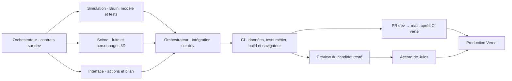

# Feedo · Coordination

Le fil principal est responsable de l’architecture, des décisions transverses, des tests, des revues et de la livraison. Les trois agents de développement livrent des lots Git indépendants. Les trois personnages de formation interviennent dans le produit auprès de l’apprenant.

## Graphe horizontal

## Interfaces et questions

Le contrat métier est dans [la mission simulation](docs/agents/simulation.md). Les modules s’échangent l’état par événements navigateur. Le code de la salle et le modèle de formation restent indépendants. Chaque sous-agent transmet au parent toute ambiguïté avec la décision qu’il propose. L’orchestrateur répond et enregistre les arbitrages qui changent le contrat. Les seules données décrivant le réseau d’eau sont simulées.

## Intégration de la salle 3D

- Le GLB utilise des mètres et le repère Three.js. Le sol est à `Y = 0`, `+Y` monte, `+X` pointe vers la façade vitrée et `+Z` vers le fond vitré et `-Z` vers le bar d’entrée.
- Le volume principal est estimé à 11,8 × 40 m. Le plafond est à 4,75 m et les plaques à 3,50 m. Le renfoncement mesure 3 × 2,4 m. La porte vitrée de 3 × 3 m est sur le mur latéral droit vu vers le fond vitré. Les quatre écrans longent le mur blanc côté entrée et la façade vitrée côté fond, deux dans chaque moitié.
- La caméra d’observation peut partir de `(0, 1.65, -12.4)` et viser `(-0.49, 2.28, -19.4)`. Pour une vue centrale, partir de `(0, 1.65, 0)`.
- Charger le GLB avec `GLTFLoader.loadAsync()` et ajouter `gltf.scene` à la scène éclairée. Les meubles et piliers qui bloquent le déplacement portent `userData.collision = true`.
- La visite sur Vercel charge le modèle via `VITE_ROOM_MODEL_URL`. En local, `npm run dev` génère et sert le même GLB à `/salle.glb`. [Modèle sur Vercel Blob](https://jsrq5sfsnxgxzith.public.blob.vercel-storage.com/salle-hackathon-40m-UfzCGPk41GZJFfm19qR5N324G6KDrM.glb)

